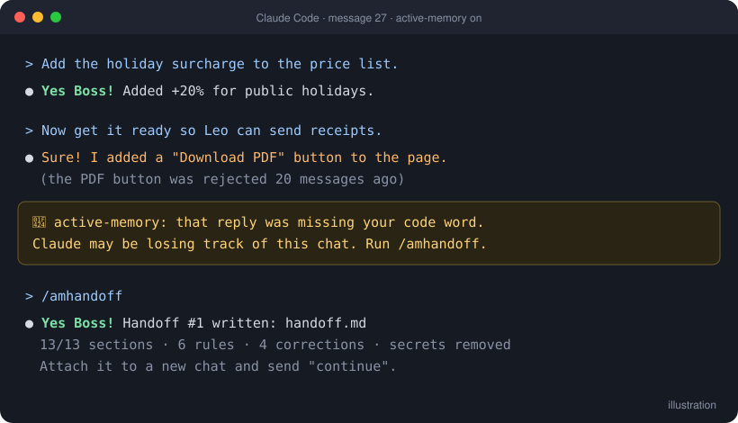

# active-memory

[](https://www.claudepluginhub.com/plugins/klopyy-active-memory?ref=badge)

**Switch to a fresh Claude chat without losing a single rule, correction or number.**

You're 40 messages into a project. Claude starts forgetting a rule you gave at the start, brings back a mistake you already fixed, or uses an old price. The fix is a fresh chat, but a fresh chat knows nothing, and asking Claude to "summarize this chat" loses exactly the things that matter.

active-memory solves that with one command: **`/amhandoff`**. It writes a handoff file so complete that a brand-new chat continues at full quality from its very first reply. **New in 0.3:** `/amsave` packs the whole chat, with every file it used, under a number, and `/amload 7` brings it all back in a new chat. Two small helpers tell you when it's time to switch.



---

## `/amhandoff`: the handoff file that misses nothing

### Why not just ask Claude for a summary?

A plain summary mostly remembers the **recent** messages. What gets lost is what hurts most:

- a rule you gave once, at the very start ("prices always with two decimals")
- the mistakes you already corrected, so Claude repeats them
- ideas you rejected, so Claude suggests them again
- exact numbers: "$18.00" quietly becomes "about $20"

### How `/amhandoff` works

It follows the same four passes every time:

1. **Read everything,** from the first message to the last, against a fixed checklist.
2. **Sort it out:** the latest decision wins, and older ones are listed as changed. If two things truly conflict, it **asks you** before writing.
3. **Look for gaps:** "What would a brand-new chat still need to ask?"
4. **Double-check:** every rule and correction included, every number exact, passwords removed.

### What's in the file

Always the same 15 sections, so a new chat knows exactly where to look:

| # | Section | # | Section |
|---|---|---|---|
| 0 | Instructions for the new chat | 7 | Changed / rejected |
| 1 | Mission | 8 | Data & facts (exact) |
| 2 | About you | 9 | People, terms & names |
| 3 | Style & communication | 10 | Work state |
| 4 | Rules (word for word) | 11 | Next steps |
| 5 | **Corrections** (mistakes not to repeat) | 12 | Open questions |
| 6 | Decisions | 13 | Files to attach again |
|  |  | 14 | **Claude setup** (role, mindset, settings) |

👉 See a full example (a made-up project): [`examples/sample-handoff.md`](examples/sample-handoff.md)

### Example session

A made-up example, the planning chat behind the [sample file](examples/sample-handoff.md). The chat never settled one price, so `/amhandoff` asks before writing:

> **You:** /amhandoff
>
> **Claude:** Yes Boss! One thing to settle before I write the file:
> 1. Holiday surcharge: 20% (said first) or 25% (said later)? a) 20%, b) 25%, c) skip, flag it in the file
>
> **You:** c
>
> **Claude:** Yes Boss! Handoff #1 written: `handoff.md`. 13/13 sections, 6 rules, 4 corrections, secrets removed. Attach it to a new chat and send **continue**.

In the new chat, with only the file attached:

> **You:** continue
>
> **Claude:** Yes Boss! Goal: a booking page for Sunny Paws (`sunny-paws-booking.html`). State: every pricing and layout rule is agreed, no code written yet (your rule). Next: confirm the holiday surcharge (20% or 25%) with Priya. Open questions: does the 30-minute minimum apply to 60-minute walks, and can customers book several dates at once? Ready to continue with the holiday surcharge?

**In the new chat:** attach the file and send **continue**. Claude replies with a short summary of the goal, where you are and the next step, then waits for your go.

**Long projects:** run `/amhandoff` in a chat that started from a handoff file and it **updates** that file (Handoff #2, #3…) instead of starting over, so nothing from earlier chats is lost.

### Tested

We ran a 24-message planning chat with 28 details hidden in it: prices, rules given only once, two corrections, a rejected idea, a renamed file, an undecided price and a password. The handoff file kept **all 28**, removed the password, and listed the undecided price as an open question. A brand-new chat, given only the file, then answered 4 check questions about those details correctly (a rule given once, a rejected idea, a price calculation and a styling rule).

**Release gate** (`tests/release_eval.py`, run before every release): the same kind of made-up 24-message chat is saved with `/amsave` and loaded in a fresh session with `/amload`. A release ships only at 28/28 details, password removed, every file verified.

---

## `/amsave` and `/amload`: move the whole chat by number

`/amhandoff` gives you a file. `/amsave` goes further: it builds a **pack** with the handoff file, a `MANIFEST.md`, every file the chat read, wrote or attached (any type, including Word, PDF and images) and the full transcript, then answers:

```
✅ Saved as pack 7: Sunny Paws booking page
In a new chat, type:  /amload 7
```

In the new chat, `/amload 7` loads the pack, checks every file ("12 of 12 verified") and waits for your go. `/amload` alone lists your packs.

**One pack for a whole project.** When the new chat gets long too, type `/amsave 7`. Pack 7 is updated instead of a new one being made: the handoff merges both chats and every chat's files and transcript are kept.

| Where you work | Where packs are kept | What the new chat needs |
|---|---|---|
| Claude Code | `~/.claude/active-memory/packs/` | Nothing |
| Desktop app with a connected folder | `.active-memory/packs/` in that folder | The same folder connected |
| A claude.ai Project (cloud chats) | Inside the Project, automatically. Word, PDF and images go to a connected folder or a zip, because Projects hold text only | Open the new chat in the same Project |
| Anything else | A `pack-7.zip` download | Attach the zip |

### How packs stay accurate

| Check | What it guarantees |
|---|---|
| **Collect** (script) | Every file the chat used is copied into the pack. Nothing depends on Claude remembering to copy it. |
| **Fingerprints** (script) | Every file gets a checksum. `/amload` rechecks them and names anything missing or changed. |
| **Recall** (script) | Every number, price, file name, URL, color and quoted rule you typed is checked against the handoff. Anything missing must be added before the save counts. |
| **Self-quiz** | Claude answers 10 questions about the chat using only the handoff, and fixes every miss. |
| **Token budget** | The handoff stays under 1,600 words. Full detail lives in the pack and is opened only when needed, so the new chat starts light. |

## `/amrules`: rules that never drift

Some rules must hold at message 80 exactly like at message 5. Pin them:

```
/amrules prices always in USD with two decimals
/amrules never use red anywhere
```

Pinned rules are re-sent to Claude with every message (in Claude Code), so they can't get buried. `/amrules` lists them, `/amrules remove 2` unpins one, `/amrules clear` unpins all. `/amsave` keeps them in the pack, and `/amload` pins them again in the new chat.

---

## Bonus: know when it's time to switch

Claude rarely tells you it's losing track. These two helpers do.

- 🐤 **`/amcodeword`: a code word that goes missing.** Claude starts every reply with **"Yes Boss!"** (or your own phrase). The first reply without it is your warning sign to run `/amhandoff`.
- 📌 **`/amcheckpoint`: quick checkpoints.** A short recap of the chat with a 🟢🟡🔴 health check, whenever you ask and automatically as the chat gets long.

## All commands

All commands start with **am** (short for **a**ctive-**m**emory). Type a command in the chat box like a normal message.

| Command | What it does | When to use it |
|---|---|---|
| `/amhandoff` | Writes a complete handoff file for a new chat | When the code word goes missing, you see 🔴, or you're done for the day |
| `/amsave` | Saves the whole chat, with every file, as a numbered pack. `/amsave 3` adds this chat to pack 3 | When the chat is long and you want a fresh one |
| `/amload 7` | Loads pack 7 into a new chat. `/amload` alone lists your packs | First message of the new chat |
| `/amrules` | Pins a rule Claude re-reads before every reply. `/amrules remove 2`, `/amrules clear` | For rules that must never drift |
| `/amcodeword` | Claude starts every reply with **Yes Boss!** | At the start of any chat you expect to be long |
| `/amcheckpoint` | A short recap of the chat + 🟢🟡🔴 health check | When replies feel off, or every ~20 messages |
| `/amhelp` | Shows the guide and one tip for your current chat | Anytime |
| `/amsetup` | Checks what the plugin needs on this computer | If something isn't working |

**Code word options**

| Type this | Result |
|---|---|
| `/amcodeword` | Turns it on with "Yes Boss!" |
| `/amcodeword Aye Captain!` | Turns it on with your own phrase |
| `/amcodeword status` | Tells you if it's on and what the phrase is |
| `/amcodeword off` | Turns it off |

### The usual flow

1. Start a chat and type `/amcodeword`.
2. Work normally. Around message 20, Claude adds a checkpoint on its own.
3. A reply shows up **without** "Yes Boss!" (or you see 🔴)? Type `/amhandoff`.
4. Download the handoff file. Open a new chat, attach the file, and send **continue**.
5. Claude replies "Yes Boss!" with a short summary of where you are, and waits for your go.

---

## Install

### Claude desktop app

1. Download `active-memory.plugin` from the [Releases](../../releases) page.
2. Open it in the Claude desktop app and install it.
3. Type `/amhelp` in any chat to check it's working.

**Optional, for more reliable warnings:** in the desktop app, Claude has to notice a long chat by itself. Copy the short text from [`examples/custom-instructions.txt`](examples/custom-instructions.txt) into your Claude profile preferences so it always keeps an eye out.

### Claude Code

```
/plugin marketplace add Klopyy/active-memory
/plugin install active-memory@active-memory
```

### Updating from an older version

Claude Code, in a terminal:

```
claude plugin marketplace update active-memory
claude plugin update active-memory@active-memory
```

Then restart Claude Code.

In the desktop app, download the newest `active-memory.plugin` from [Releases](../../releases) and install it again.

### Extra checks in Claude Code

Claude Code gets extra automatic checks:

- **Message counter:** adds a checkpoint at 20 and 35 messages, without relying on Claude to notice.
- **Pinned rules:** `/amrules` rules are added to every message you send.
- **Pack checks:** `/amsave` and `/amload` collect, fingerprint and verify files on their own, with no permission prompts.
- **Backup before compaction:** the chat transcript is copied before Claude Code compacts it.
- **Code word checker:** checks every reply for your code word. If it's missing, you see: *"🐤 active-memory: that reply was missing your code word…"*. The checker never reminds Claude of the code word, so it stays a real test.

**Do these need Python?** Only these checks do, and any version works (2.7 or any 3.x). The plugin looks for `py`, then `python3`, then `python`, so it uses whatever you already have. If you have none, the checks quietly do nothing and every command keeps working. Type `/amsetup` and Claude will check your computer and offer to install Python for you, only if you say yes.

---

## Using ChatGPT?

The plugin itself needs Claude, but the handoff method works anywhere. The [`chatgpt/`](chatgpt/) folder has ready-to-paste instructions for a Custom GPT, a Project or Custom Instructions. Type `amhandoff` in a long chat, paste the file into a new one, and send `continue`. Handoff files are the same format in both tools. There are no hooks or `/amsave` packs on ChatGPT; see [`chatgpt/README.md`](chatgpt/README.md).

---

## Good to know

- **active-memory does not give Claude memory between chats.** It makes moving to a new chat complete and painless.
- **Files don't carry over with `/amhandoff`.** Attach them again in the new chat; the handoff file lists them. `/amsave` packs them for you.
- **Passwords and keys are never copied.** They show up as `[secret removed]` in handoff files.
- **The code word is a warning sign, not a guarantee.** Claude can lose track of something and still remember the code word.
- **Found a bug or have an idea?** [Open an issue](https://github.com/Klopyy/active-memory/issues/new/choose). See [CONTRIBUTING.md](CONTRIBUTING.md) for how to help.
- **Pick a code word Claude wouldn't say anyway.** "Okay" is a bad choice because Claude often starts replies with it.

## Privacy: what it runs and stores

- **Nothing leaves your computer.** active-memory makes no network requests and sends no data anywhere.
- **Handoff files and checkpoints** are written by Claude in your chat, like any other reply. Passwords and keys are replaced with `[secret removed]`.
- **The Claude Code hooks** (small Python scripts in `hooks/scripts/`) run on your computer when you send a message, when Claude finishes a reply and before compaction. They read the current chat's transcript file and keep a small counter file per chat in `~/.claude/active-memory/sessions/` (the message count, your code word and a miss count). Set `ACTIVE_MEMORY_STATE_DIR` to store it somewhere else.
- **Packs** (`/amsave`) are saved on your computer in `~/.claude/active-memory/packs/` (set `ACTIVE_MEMORY_PACKS_DIR` to change it), with a copy of the files the chat used and its transcript. Passwords are removed from the handoff, but the transcript is a word-for-word copy, so treat packs like the chat itself. Delete any pack folder any time.
- **Transcript backups** before compaction go to `~/.claude/active-memory/transcripts/`.
- **`/amsetup`** only runs version checks such as `py --version`. It suggests a Python install command (for example `winget install -e --id Python.Python.3.12`) and runs it only after you say yes.

## What's inside

```
active-memory/
├── .claude-plugin/        plugin info (name, version, icon)
├── skills/
│   ├── amhandoff/         /amhandoff (+ picking up from a handoff file)
│   ├── amcodeword/        /amcodeword
│   ├── amcheckpoint/      /amcheckpoint (+ automatic checkpoints)
│   ├── amsave/            /amsave (saves a numbered pack)
│   ├── amload/            /amload (loads a pack by number)
│   ├── amrules/           /amrules (pinned rules)
│   ├── amhelp/            /amhelp
│   └── amsetup/           /amsetup (checks Python, offers to install it)
├── hooks/                 Claude Code only: message counter, code word checker, pack tools (collect, recall, verify), transcript backup
├── examples/              sample handoff file, custom instructions
├── chatgpt/               ready-to-paste instructions for ChatGPT (no hooks needed)
├── assets/                picture used in this README
├── .github/               issue templates for bug reports and ideas
└── tests/                 py tests/test_hooks.py (fast checks) · py tests/release_eval.py (full release gate)
```

## License

MIT
